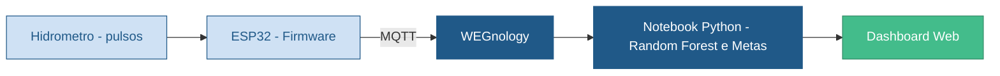
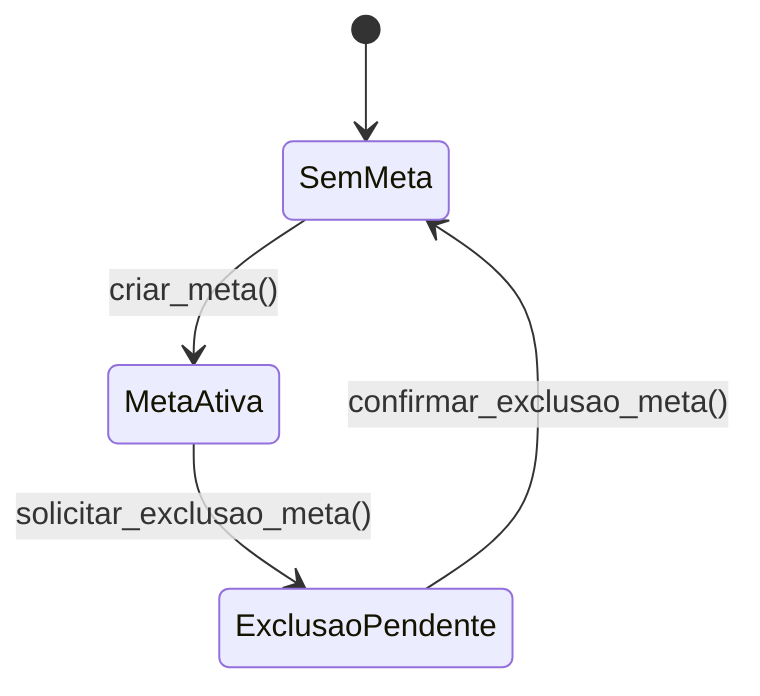

<div align="center">


<a href="https://github.com/ankitjha/readme-typing-svg"></a>

<br/>


[📍 Status](#-status-atual-do-projeto) •
[🔭 Visão geral](#-visão-geral) •
[🧰 Stack](#-stack-tecnológica) •
[🗂️ Estrutura](#️-estrutura-do-projeto) •
[🧩 Componentes](#-componentes-do-sistema) •
[🚀 Como executar](#-como-executar) •
[🧭 Próximos passos](#-próximos-passos-sugeridos)

</div>

---

Projeto de monitoramento e previsão de consumo de água, com foco em redução de desperdício, estimativa de custo e visualização de metas de consumo. O estado atual reúne três pilares principais: **coleta de dados no dispositivo IoT**, **modelagem preditiva em Python** e **interface web** para demonstração do sistema.

## 📍 Status atual do projeto

📌 **O projeto está em desenvolvimento** e já apresenta as seguintes etapas concluídas:

- ✅ Firmware para ESP32 com leitura de pulsos de hidrômetro.
- ✅ Envio de dados para plataforma MQTT/WEGNOLOGY.
- ✅ Modelagem de previsão de consumo utilizando Random Forest.
- ✅ Estrutura inicial da interface web para cadastro, login, metas, configurações e relatórios.
- ✅ Gerenciamento de uma meta ativa por vez, com persistência em JSON.
- ✅ Função para gerar os dados anuais de consumo para gráficos.
- ✅ Arquivos de dados e workflows para simulação de consumo e geração de gráficos.

🚀 **Etapas de evolução do produto também concluídas:**

- ✅ Integração real entre frontend e backend/dados.
- ✅ Integração do formulário da interface com o gerenciamento de metas em Python.
- ✅ Autenticação e fluxo completo de usuário.
- ✅ Conexão do dashboard com dados em tempo real.
- ✅ Refinamento do modelo com dados reais e validação operacional.
- ✅ Ajustes de segurança para credenciais e endpoints de IoT.

## 🔭 Visão geral

O Hydranomic busca transformar o consumo de água em informação útil para o usuário. A ideia principal é combinar leitura do hidrômetro, previsão de faturamento e acompanhamento de metas para ajudar na gestão do recurso hídrico.



## 🧰 Stack tecnológica

| Camada | Tecnologias |
| :--- | :--- |
| 🧠 Análise |    |
| 📟 IoT |   |
| 🖥️ Frontend |    |
| 💾 Dados |  armazenamento de dados e workflows |

## 🗂️ Estrutura do projeto

<details open>
<summary><b>Clique para expandir / recolher</b></summary>

```text
Hydranomic/
├── requirements.txt
├── README.md
├── hydranomic/
│   ├── assets/
│   ├── experience/
│   │   ├── cadastro.html
│   │   ├── configuracoes.html
│   │   ├── definicoes.html
│   │   ├── esqueceu_senha.html
│   │   ├── index.html
│   │   ├── login.html
│   │   ├── metas.html
│   │   ├── navbar.html
│   │   ├── relatorio.html
│   │   └── css/
│   │       ├── configuracoes.css
│   │       ├── definicoes.css
│   │       ├── global.css
│   │       ├── index.css
│   │       ├── login.css
│   │       ├── metas.css
│   │       ├── navbar.css
│   │       └── relatorio.css
│   ├── firmware/
│   │   ├── main.cpp
│   │   ├── platformio.ini
│   │   └── script.cc
│   ├── notebooks/
│   │   ├── app.py
│   │   ├── data_chart.py
│   │   ├── machinelearning.py
│   │   └── metas.py
│   └── workflows/
│       ├── conta.json
│       ├── conta_povoada.json
│       ├── config.json
│       └── grafico_anual.json
```

</details>

## 🧩 Componentes do sistema

### 1. 📟 Firmware IoT

A parte de hardware está localizada em `hydranomic/firmware/` e utiliza um ESP32 para:

- ler pulsos de hidrômetro;
- contar eventos de consumo;
- conectar em Wi-Fi;
- publicar dados em um broker MQTT.

Arquivo principal:

- `hydranomic/firmware/main.cpp`

⚠️ **Atenção:** as credenciais de rede e do broker estão atualmente codificadas no código. Em uma próxima etapa, esse dado deve ser movido para variáveis de ambiente ou arquivo de configuração seguro.

### 2. 🧠 Machine Learning / Previsão

A lógica de previsão está em `hydranomic/notebooks/machinelearning.py`.

Ela:

- lê os dados de consumo em JSON;
- organiza o histórico por unidade consumidora e período;
- calcula variáveis temporais e de memória do consumo anterior;
- treina um modelo de regressão com `RandomForestRegressor`;
- estima o consumo do próximo mês;
- calcula o valor da conta com base na tarifa atual.

A função principal é:

- `iniciar_ml()`

Ela retorna um dicionário com os dados de previsão, como:

- ano e mês previstos;
- unidade consumidora;
- consumo estimado em m³;
- tarifa;
- valor estimado da conta.

### 3. 🖥️ Interface web

A pasta `hydranomic/experience/` contém páginas estáticas para:

- login;
- cadastro;
- configurações;
- metas;
- relatórios;
- página inicial e navegação.

Essas telas já dão a estrutura visual do produto e servem como base para a implementação do frontend completo.

### 4. 🎯 Gerenciamento de metas

A lógica de metas está em `hydranomic/notebooks/metas.py` e utiliza `hydranomic/workflows/config.json` para persistência.

Regras implementadas:

- somente uma meta pode estar ativa por vez;
- nome, valor positivo e período são obrigatórios;
- o pedido de exclusão fica registrado como pendente;
- a meta só é removida após a confirmação da exclusão;
- depois da confirmação, uma nova meta pode ser criada.



Funções disponíveis:

| Função | Descrição |
| :--- | :--- |
| `carregar_config()` | carrega a configuração atual |
| `criar_meta(...)` | cria a única meta permitida |
| `solicitar_exclusao_meta()` | registra o pedido de exclusão |
| `confirmar_exclusao_meta()` | confirma e remove a meta |

Exemplo de uso:

```python
from hydranomic.notebooks.metas import criar_meta

meta = criar_meta(
	tipo="economia-mensal",
	nome="Economia de outubro",
	valor=2300,
	periodo="2026-10",
)
```

### 5. 💾 Dados e workflows

Os dados utilizados para simulação e gráficos ficam em `hydranomic/workflows/`:

- `conta.json` — base de consumo;
- `conta_povoada.json` — dados enriquecidos para treino e simulação;
- `config.json` — configuração persistida da meta;
- `grafico_anual.json` — dados para geração da visualização anual.

## 🚀 Como executar

### Requisitos

- Python 3.10 ou superior
- pip
- PlatformIO para firmware ESP32 (opcional se for testar o hardware)

### 📦 Instalação de dependências Python

No diretório raiz do projeto:

```bash
pip install -r requirements.txt
```

### 🤖 Execução do modelo de previsão

A partir da pasta `hydranomic/notebooks`:

```bash
cd hydranomic/notebooks
python app.py
```

Esse exemplo chama a função `iniciar_ml()` e imprime o resultado da previsão.

📝 **Observação:** o arquivo `app.py` ainda está em fase de integração e utiliza um seletor de estado; com `estado_atual = 0`, nenhuma operação é executada automaticamente.

### 📈 Geração dos dados do gráfico anual

A função `gerar_dados_grafico()` recebe os registros de consumo e retorna um dicionário com o ano de referência, o mês atual e os valores dos doze meses:

```python
from hydranomic.notebooks.data_chart import gerar_dados_grafico

dados_grafico = gerar_dados_grafico(registros, ano_referencia=2026)
```

### 🎯 Gerenciamento de metas

As funções de metas podem ser chamadas por um notebook, por um backend ou por outro módulo Python. Elas salvam automaticamente as alterações em `hydranomic/workflows/config.json`.

### 🌐 Execução da interface web

Abra os arquivos HTML diretamente no navegador ou utilize um servidor local simples, por exemplo:

```bash
cd hydranomic/experience
python -m http.server 8000
```

Depois acesse:

```text
http://localhost:8000
```

### 🔌 Firmware ESP32

Abra a pasta `hydranomic/firmware` em um ambiente PlatformIO e faça o upload para a placa:

```bash
pio run -t upload
```

Além disso, é necessário ajustar o SSID, senha Wi-Fi e configurações MQTT no arquivo `main.cpp` antes de uso em ambiente real.

## 📚 Dependências principais

```text
pandas==3.0.6
scikit-learn==1.9.1
```

## 🧭 Próximos passos sugeridos

- [x] 1. Integrar o formulário frontend ao gerenciamento de metas em Python.
- [x] 2. Integrar o frontend com os dados do modelo e do backend.
- [x] 3. Conectar o dashboard a entradas reais do hidrômetro.
- [x] 4. Implementar autenticação e cadastro de usuários.
- [x] 5. Migrar credenciais para variáveis de ambiente ou arquivo seguro.
- [x] 6. Validar o modelo com dados reais e aumentar a qualidade das previsões.
- [ ] 7. Criar API para expor os resultados do sistema para o frontend.

## 📝 Observações finais

Este README descreve o projeto até o estágio atual identificado no repositório. A base funcional já está montada em torno de consumo, previsão e visualização, mas o projeto ainda segue em evolução para se tornar uma solução totalmente integrada e pronta para uso em produção.

<div align="center">


**💧 Hydranomic — transformando consumo de água em informação útil.**

</div>
