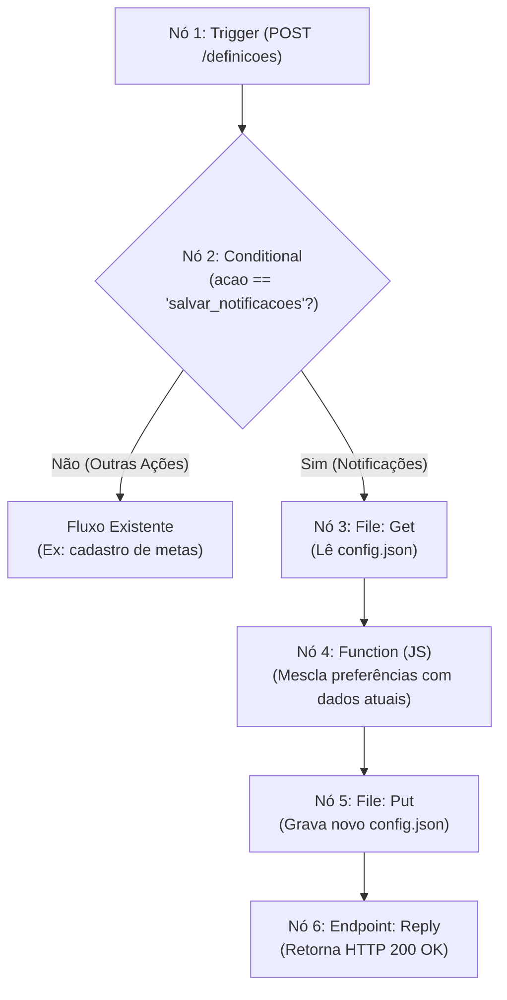

# Guia de Implementação: Experience Workflow de Notificações no WEGnology

Este documento detalha o processo de configuração do **Experience Workflow** na plataforma WEGnology para receber requisições `POST` da tela de configurações, persistir as preferências do usuário no arquivo `config.json` (em *Application Files*) e responder à requisição HTTP do navegador de forma rápida e segura.

---

## 1. Arquitetura da Solução

O fluxo foi desenhado para ser executado diretamente na camada de *Experience Workflow* da WEGnology, utilizando nós nativos de manipulação de arquivo (`File: Get` e `File: Put`), eliminando a necessidade de iniciar um container de Jupyter Notebook a cada simples clique de checkbox.



---

## 2. Contrato de Comunicação (Payload HTTP)

Quando o usuário alterna qualquer um dos checkboxes na página `configuracoes.html`, a aplicação dispara uma requisição com o seguinte formato:

- **Método**: `POST`
- **URL**: `http://hydranomic.kadly.com.br/definicoes`
- **Headers**: `Content-Type: application/json`
- **Body**:
  ```json
  {
    "acao": "salvar_notificacoes",
    "notificacoes": {
      "notificacao_prazos": true,
      "alerta_status": false
    },
    "notificacao_prazos": true,
    "alerta_status": false
  }
  ```

---

## 3. Configuração Passo a Passo dos Nós no WEGnology

Acesse o console WEGnology, navegue até **Workflows** > **Experience Workflows** e abra (ou crie) o workflow associado ao endpoint `/definicoes`.

### Nó 1: Endpoint (Trigger)
- **Categoria**: *Triggers*
- **Tipo de Nó**: `Experience: Endpoint`
- **Configuração**:
  - **Method**: `POST`
  - **Route**: `/definicoes` (ou a rota customizada do seu projeto)
- **O que faz**: Inicia o workflow assim que uma requisição HTTP chega ao servidor.

---

### Nó 2: Conditional (Roteador de Ações)
- **Categoria**: *Logic*
- **Tipo de Nó**: `Conditional`
- **Configuração**:
  - **Expression**:
    ```handlebars
    {{data.body.acao}} === 'salvar_notificacoes'
    ```
- **Conexões**:
  - **Caminho Falso (False)**: Conecte ao fluxo anterior do seu sistema (ex: cadastro de metas via `definir_meta`).
  - **Caminho Verdadeiro (True)**: Conecte à entrada do Nó 3 (`File: Get`).

---

### Nó 3: File: Get (Leitura do Arquivo Atual)
- **Categoria**: *Data*
- **Tipo de Nó**: `File: Get`
- **Configuração**:
  - **Storage Type**: `Application Files`
  - **File Path**: `config.json`
  - **Result Path**: `working.configAtual`
- **O que faz**: Baixa o conteúdo atual de `config.json` e armazena na memória temporária do workflow sob a variável `working.configAtual`.

---

### Nó 4: Function (Mesclagem Segura em JavaScript)
- **Categoria**: *Logic*
- **Tipo de Nó**: `Function`
- **Configuração**:
  Cole o código JavaScript abaixo no editor de texto do nó:

```javascript
// 1. Tenta carregar o JSON existente sem quebrar caso o arquivo esteja vazio
let config = {};
try {
  if (typeof payload.working.configAtual === 'string') {
    config = JSON.parse(payload.working.configAtual);
  } else if (payload.working.configAtual && typeof payload.working.configAtual === 'object') {
    config = payload.working.configAtual;
  }
} catch (erro) {
  config = {};
}

// 2. Preserva meta_ativa, metas_por_mes e garante o objeto de notificações
if (!config.notificacoes || typeof config.notificacoes !== 'object') {
  config.notificacoes = {
    notificacao_prazos: true,
    alerta_status: true
  };
}

// 3. Extrai as preferências recebidas da requisição HTTP
const body = payload.data.body || {};
const notifs = body.notificacoes || {};

// Atualiza 'notificacao_prazos' se enviado
if (notifs.notificacao_prazos !== undefined) {
  config.notificacoes.notificacao_prazos = Boolean(notifs.notificacao_prazos);
} else if (body.notificacao_prazos !== undefined) {
  config.notificacoes.notificacao_prazos = Boolean(body.notificacao_prazos);
}

// Atualiza 'alerta_status' se enviado
if (notifs.alerta_status !== undefined) {
  config.notificacoes.alerta_status = Boolean(notifs.alerta_status);
} else if (body.alerta_status !== undefined) {
  config.notificacoes.alerta_status = Boolean(body.alerta_status);
}

// 4. Salva a string formatada em uma variável de trabalho para o nó seguinte
payload.working.novoConfigJson = JSON.stringify(config, null, 2);
```

---

### Nó 5: File: Put (Gravação em Application Files)
- **Categoria**: *Data*
- **Tipo de Nó**: `File: Put`
- **Configuração**:
  - **Storage Type**: `Application Files`
  - **File Path**: `config.json`
  - **File Contents**: `{{working.novoConfigJson}}`
  - **Content Type**: `application/json`
- **O que faz**: Sobrescreve o arquivo `config.json` no repositório de Application Files com o novo JSON gerado.

---

### Nó 6: Endpoint: Reply (Resposta HTTP)
- **Categoria**: *Output*
- **Tipo de Nó**: `Endpoint: Reply`
- **Configuração**:
  - **Response Code**: `200`
  - **Response Body**:
    ```json
    {
      "status": "sucesso",
      "mensagem": "Preferências salvas com sucesso!"
    }
    ```
  - **Response Headers**:
    - **Name**: `Content-Type`
    - **Value**: `application/json`
- **O que faz**: Retorna o status HTTP 200 para a página `configuracoes.html`, fazendo com que a mensagem de feedback verde apareça na tela.

---

## 4. Alternativa: Executar via Jupyter Notebook

Caso você prefira que o Jupyter Notebook seja acionado a cada requisição:

1. Substitua os nós `File: Get`, `Function` e `File: Put` por um nó **Notebook: Execute** (categoria *Data*).
2. No campo **Context** do nó `Notebook: Execute`, insira:
   ```handlebars
   {{data.body}}
   ```
3. O código já implementado no **Bloco 5** (`modulo_metas`) do `hydranomic_master.ipynb` lerá `ctx.get("acao") == "salvar_notificacoes"`, atualizará o `config.json` no disco e o persistirá.
4. Conecte em seguida o nó `Endpoint: Reply` com código `200`.

---

## 5. Como Testar e Validar

1. No editor do Workflow na WEGnology, abra a aba lateral **Debug** (ícone de inseto).
2. Abra a aplicação no navegador em `http://hydranomic.kadly.com.br/configuracoes`.
3. Alterne o checkbox de **Notificações de Prazos Próximos** ou **Alertas de Mudança de Status**.
4. Observe:
   - Na página, surge o aviso sutil verde: *"Preferências salvas com sucesso!"*.
   - No painel de **Debug** da WEGnology, o payload é exibido com o caminho `data.body` contendo as variáveis booleanas.
   - Na seção **Application Files**, o arquivo `config.json` apresentará o timestamp de modificação atualizado com os novos valores.
